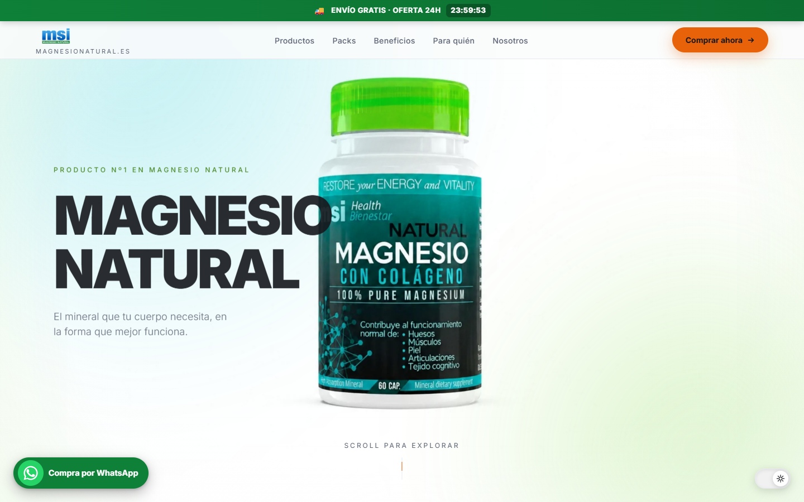
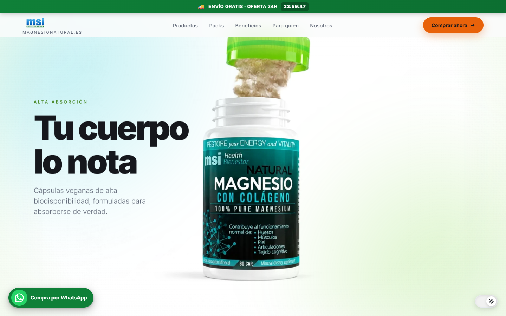
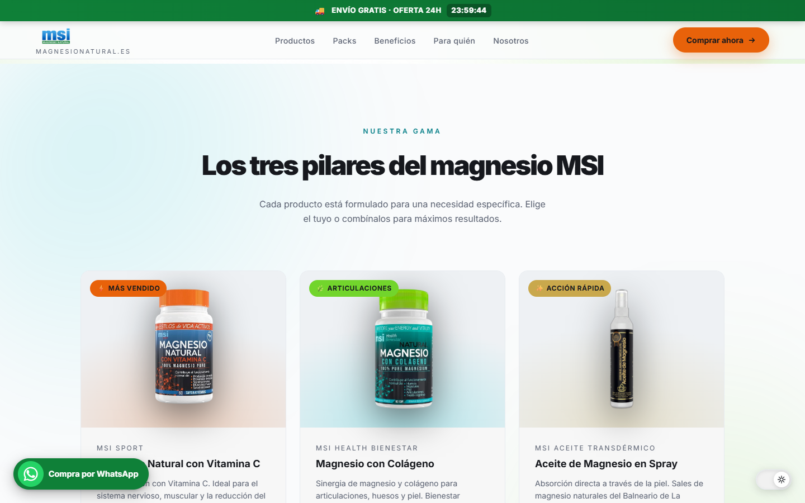
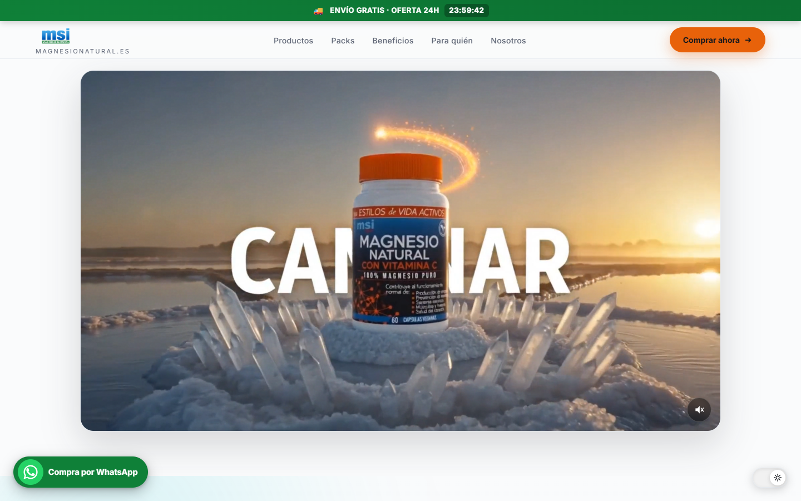
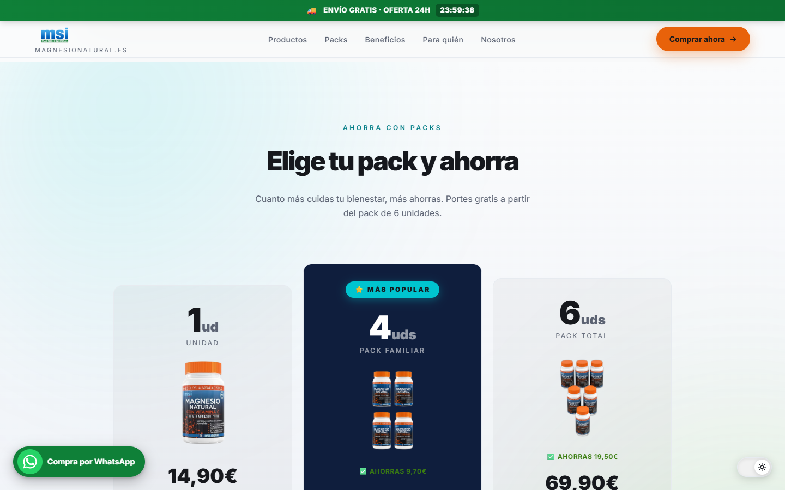
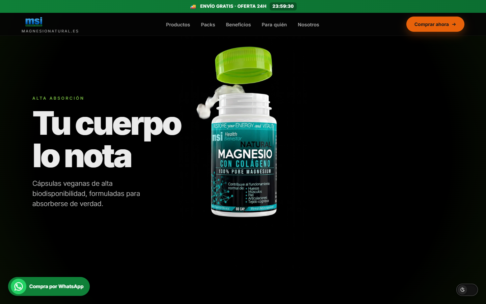
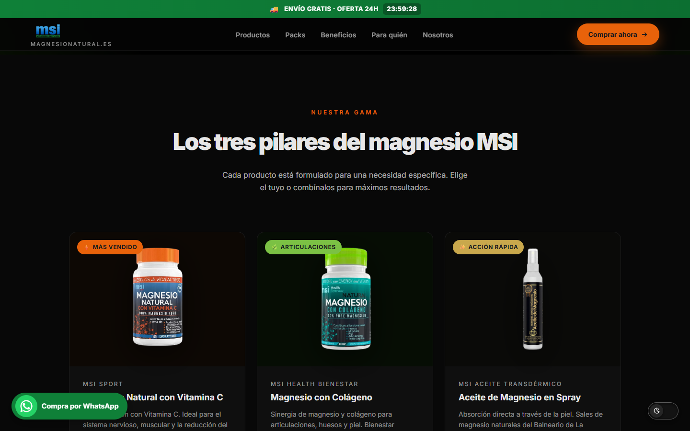
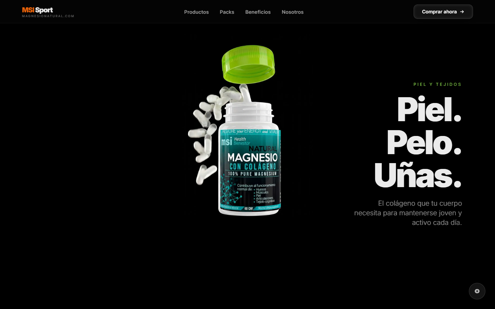
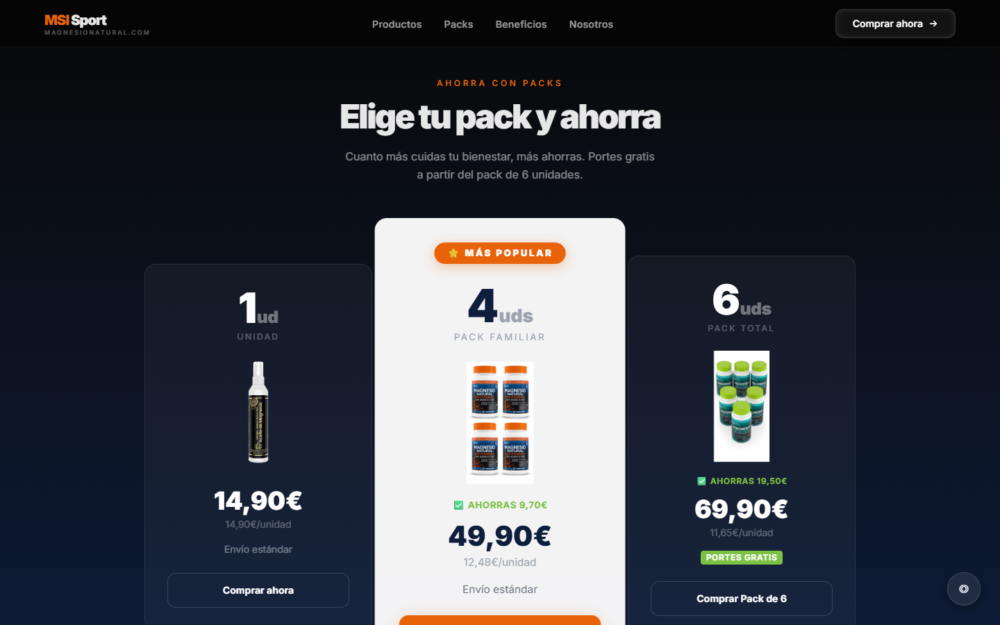
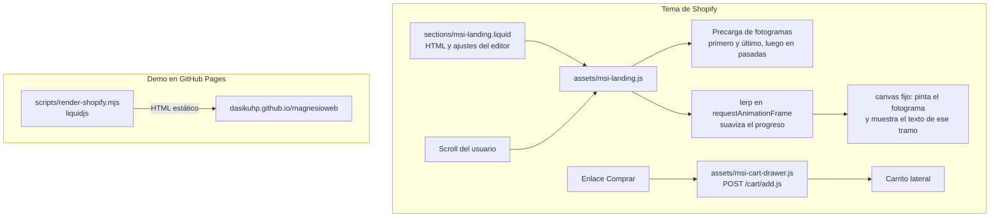

<div align="center">
  <h1>MSI · magnesio natural</h1>
  <p>Tienda en Shopify con animación por scroll para una marca real de magnesio, y el prototipo en Next.js del que salió.</p>

  <p>
    
    
    
    
    
    
  </p>
  <p>
    <a href="https://dasikuhp.github.io/magnesioweb/"><strong>Ver la demo</strong></a> ·
    <a href="https://dasikuhp.github.io/magnesioweb/nextjs/">Prototipo en Next.js</a> ·
    <a href="https://github.com/DasikuHp/magnesioweb/actions/workflows/ci.yml"></a>
    
  </p>
</div>

Es la web que hice para MSI, una marca que vende magnesio natural en cápsulas y en aceite. Se publica aquí con su permiso. Empecé con un prototipo en Next.js (abril y mayo de 2026) y después lo pasé a un tema de Shopify, que estuvo en producción en la tienda de la marca en julio de 2026. Esa tienda ya no está online, así que la demo es el mismo tema renderizado como página estática.

Al bajar por la página, un bote se abre y las cápsulas salen volando mientras aparecen los textos de cada beneficio. Debajo están los productos con su precio, un vídeo-anuncio, los packs, para quién es cada producto, la sección "Nosotros" y el estudio clínico en el que se apoya la marca.

https://github.com/user-attachments/assets/b8743d23-5fdd-4a43-84c0-dce79aa91ad1

<sub>La versión final en el ordenador: animación en tema claro, productos, vídeo-anuncio, packs, evidencia y la misma animación en tema oscuro.</sub>

## La versión final (tema de Shopify)

| Inicio (tema claro) | Animación | Productos |
| :---: | :---: | :---: |
|  |  |  |
| **Vídeo-anuncio** | **Packs** | **Evidencia** |
|  |  |  |
| **Tema oscuro: animación** | **Tema oscuro: productos** | |
|  |  | |

- Tema claro por defecto y oscuro con el botón de abajo a la derecha. Cada tema tiene su propia secuencia de fotogramas (bote sobre fondo blanco o negro) y la elección se guarda en el navegador.
- Productos y packs con su precio. "Comprar" añade al carrito sin salir de la página y abre un carrito lateral.
- Páginas propias de producto y de carrito con el mismo diseño.
- Barra de oferta con cuenta atrás y envío gratis en los packs mientras dura.
- Botón de WhatsApp, favicon, datos estructurados para Google y una sección con el estudio del Hospital Clínic que se abre en un visor con zoom.
- Todo se edita desde el editor de temas de Shopify: textos, precios, imágenes, colores, la oferta o el teléfono de WhatsApp.

En el móvil la animación usa una versión más ligera (61 fotogramas más pequeños) y coloca el bote abajo y el texto arriba para que no se pisen:

https://github.com/user-attachments/assets/befccc5e-86c9-414c-a0ca-1cd909c9c791

## El prototipo en Next.js

Es la primera versión: solo la landing, con tema oscuro y sin tienda detrás. Tiene tres animaciones (una por producto) y cada visita elige una al azar. Se puede ver en [/nextjs](https://dasikuhp.github.io/magnesioweb/nextjs/).

| Animación | Productos | Packs | Móvil |
| :---: | :---: | :---: | :---: |
|  |  |  |  |

## Stack

| Parte | Tecnologías |
| :--- | :--- |
| Tema de Shopify | Liquid (secciones, snippets y plantillas JSON), CSS y JavaScript sin librerías, API AJAX del carrito de Shopify, Shopify CLI |
| Prototipo | Next.js 16 (exportación estática), React 19, TypeScript, Tailwind CSS 3, Framer Motion 12 |
| Imágenes | Secuencias WebP para escritorio y móvil, en tema claro y oscuro; fotos de producto y estilo de vida en WebP |
| Demo y CI | GitHub Actions, GitHub Pages y `liquidjs` para renderizar el tema fuera de Shopify |

## Cómo funciona por dentro



La animación no es un vídeo: son imágenes WebP de la misma escena, una por fotograma (121 en escritorio, 61 en móvil). La sección mide varias pantallas de alto y tiene un `canvas` que se queda fijo (`position: sticky`). Al hacer scroll, `msi-landing.js` calcula cuánto has avanzado dentro de la sección (de 0 a 1), lo suaviza con una interpolación lineal en cada `requestAnimationFrame` (el `lerp` hace el papel del `useSpring` de Framer Motion del prototipo) y pinta en el canvas el fotograma que toca. Los textos de cada beneficio (`data-msi-beat`) aparecen y desaparecen según el tramo de scroll en el que estés.

Para que la página no tarde en verse, el primer fotograma hace de imagen de portada y el resto se descarga en varias pasadas (`buildLoadOrder`): primero el primero y el último, luego uno de cada 8, uno de cada 4, uno de cada 2 y por último todos, con un máximo de 6 descargas a la vez. Así enseguida hay fotogramas repartidos por toda la animación, y mientras falta uno se pinta el más cercano que ya esté cargado. Con `prefers-reduced-motion` no se descarga ninguna secuencia y se ve una versión estática.

Hubo un fallo en la primera visita en Safari: el script medía el canvas antes de que llegara el CSS (300 x 150 px por defecto) y la animación se veía estirada. `drawFrame()` comprueba ahora en cada pintado que el tamaño interno del canvas coincide con el que ocupa en pantalla y lo corrige si no.

El tema claro u oscuro se guarda en `localStorage` (`msi-color-mode`). Al cambiarlo se cambia también la secuencia de fotogramas, y las páginas de producto y carrito leen la misma clave, así que toda la tienda va a juego.

Los botones "Comprar" son enlaces a `/cart/add?id=<variante>`, que en Shopify ya añaden al carrito. `msi-cart-drawer.js` los intercepta, añade el producto con la API AJAX del carrito (`/cart/add.js`) y abre el carrito lateral. Si esa llamada falla, sigue el enlace normal, así que la compra nunca se queda bloqueada.

Todo lo editable está en el `` de cada sección: la marca puede cambiar textos, precios, imágenes, colores o la oferta desde el editor de Shopify sin tocar código. Lo que se escribe en esos ajustes pasa por el filtro `escape` antes de pintarse, para que no se pueda colar HTML.

La demo se genera en la CI: `scripts/render-shopify.mjs` interpreta la plantilla con `liquidjs` y simula lo que pone Shopify (`asset_url`, `money`, ``, ``…) con los valores por defecto de los ajustes. En la demo, los botones de compra y de WhatsApp muestran un aviso porque no hay tienda detrás. El prototipo de Next.js se exporta como HTML estático (`output: "export"`) y se publica en `/nextjs`.

## Estructura del proyecto

```text
magnesioweb
├── shopify/                          Tema de Shopify (versión final)
│   ├── layout/msi-landing.liquid     Plantilla base: head, SEO, favicon
│   ├── sections/                     Landing, producto, carrito y evidencia
│   ├── snippets/                     Carrito lateral, tarjetas, cabecera, pie...
│   ├── templates/                    Qué sección usa cada página (JSON)
│   ├── assets/                       JS, CSS, fotogramas, vídeo e imágenes
│   └── README.md                     Cómo instalarlo en una tienda
├── scripts/render-shopify.mjs        Renderiza el tema para la demo
├── app/, components/, hooks/, lib/   Prototipo en Next.js
├── public/                           Fotogramas e imágenes del prototipo
└── .github/workflows/ci.yml          Lint, build y despliegue en GitHub Pages
```

## Instalación

```bash
git clone https://github.com/DasikuHp/magnesioweb.git
cd magnesioweb
npm install
npm run dev              # prototipo de Next.js en http://localhost:3000
npm run render:shopify   # renderiza el tema en site/ (se abre con cualquier servidor estático)
```

Para usar el tema en una tienda real se sube la carpeta `shopify/` con [Shopify CLI](https://shopify.dev/docs/api/shopify-cli) (`shopify theme push`). `shopify/README.md` explica los pasos.

## Limitaciones

- En la demo no se puede comprar: el carrito y el pago son de Shopify.
- La cuenta atrás de la oferta se guarda en cada navegador y vuelve a empezar al terminar.
- La secuencia de escritorio pesa unos 6 MB en tema claro y 11 MB en oscuro (en el móvil, 1 MB); con conexiones lentas, los primeros segundos se ven con menos fotogramas.
- Los textos comerciales y las afirmaciones sobre el producto son los de la marca.

## Créditos y licencia

Las imágenes de producto, las fotos y los fotogramas de las animaciones los generé con herramientas de IA a partir de las fotos oficiales de los botes. La marca MSI, sus productos, sus textos y el estudio clínico son del cliente y se muestran con su permiso. En el repositorio, el email, el teléfono y la verificación de Google de la tienda se han cambiado por datos de ejemplo.

El código está bajo la [Business Source License 1.1](LICENSE): puedes leerlo, copiarlo y modificarlo y usarlo fuera de producción; el uso comercial necesita permiso y el 27 de abril de 2030 pasa a Apache 2.0. La licencia no cubre la marca ni los textos de MSI. Contacto: [dasikuhp@gmail.com](mailto:dasikuhp@gmail.com).

<div align="center">
  <sub>Hecho por <a href="https://github.com/DasikuHp">DasikuHp</a></sub>
</div>
