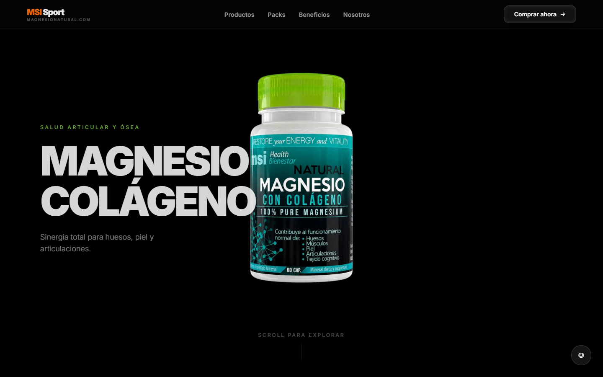
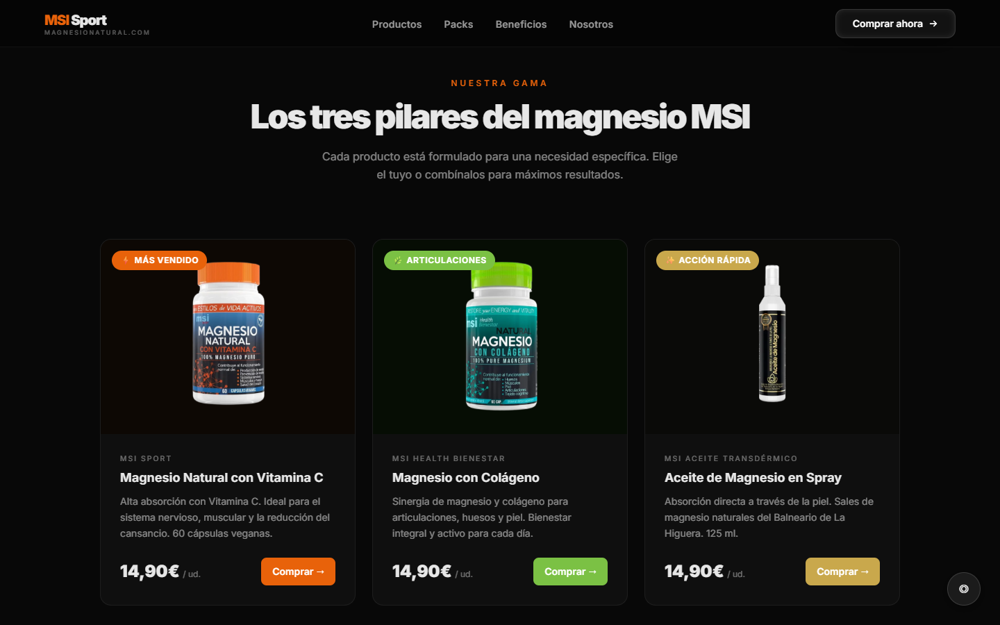
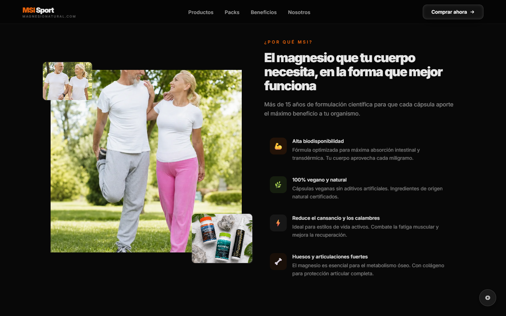
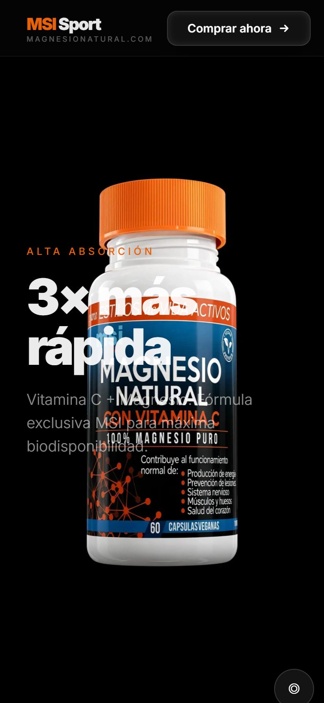
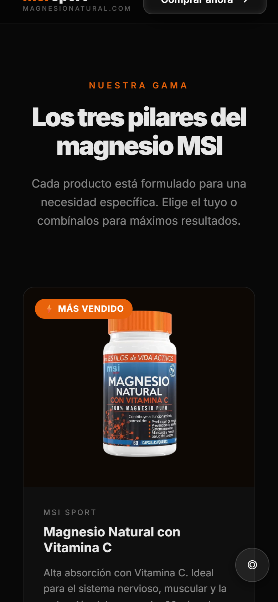
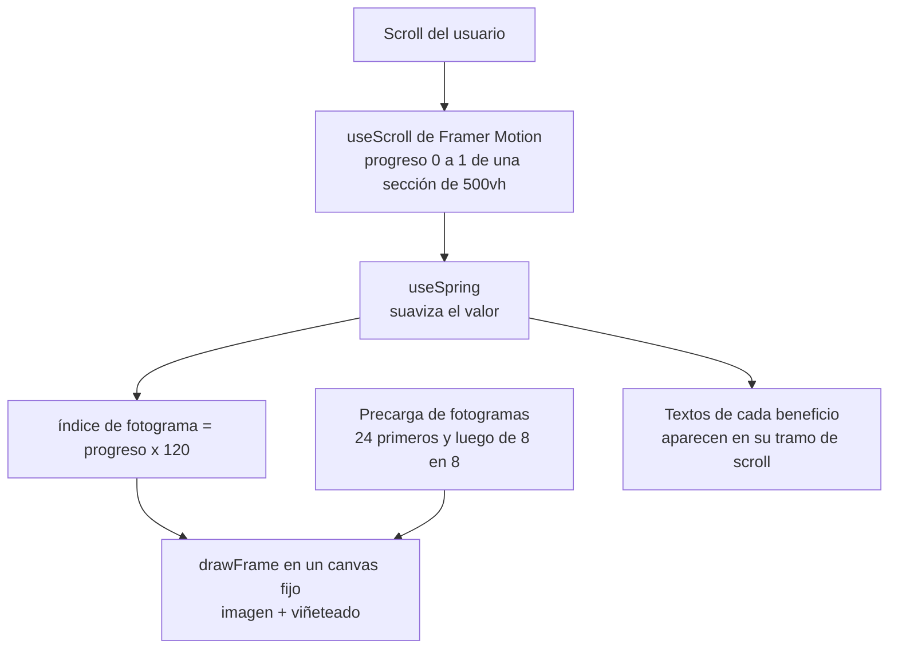

<div align="center">
  <h1>MSI Sport · landing de magnesio</h1>
  <p>Landing con animación por scroll para una marca real de suplementos de magnesio: versión en Next.js y sección para un tema de Shopify.</p>

  <p>
    
    
    
    
    
    
  </p>
  <p>
    <a href="https://dasikuhp.github.io/magnesioweb/"><strong>Ver la demo de esta versión</strong></a> ·
    <a href="https://github.com/DasikuHp/magnesioweb/actions/workflows/ci.yml"></a>
    
  </p>
</div>

Es la web que hice para MSI, una marca que vende magnesio natural en cápsulas y en aceite, y se publica aquí con su permiso. Al bajar por la página, un bote de producto se abre y las cápsulas salen volando, mientras aparecen los textos de cada beneficio. Debajo están las fichas de producto, los packs, los beneficios y la sección "Nosotros".

> **Este repositorio es una versión anterior.** La versión final la monté directamente en el tema de Shopify de la tienda: añadía un interruptor de modo claro y oscuro, la animación sobre fondo blanco, un vídeo-anuncio, precios y newsletter. Esa versión ya no está publicada y solo queda la grabación de abajo.

<!-- VIDEO_PRODUCCION -->

## Esta versión

| Inicio de la animación | Mitad de la animación |
| :---: | :---: |
|  |  |
| **Productos** | **Packs** |
|  |  |

| Beneficios | Móvil: animación | Móvil: productos |
| :---: | :---: | :---: |
|  |  |  |

Hay tres animaciones, una por producto (cápsulas naranjas con vitamina C, cápsulas verdes con colágeno y aceite en spray). Cada visita elige una al azar. El botón redondo de abajo a la derecha activa el "modo cristal", que pone un efecto de vidrio esmerilado en las tarjetas y el menú.

## Stack

| Parte | Tecnologías |
| :--- | :--- |
| Versión web | Next.js 16 (exportación estática), React 19, TypeScript, Tailwind CSS 3, Framer Motion 12 |
| Sección de Shopify | Liquid, CSS y JavaScript sin librerías (`shopify/`) |
| Imágenes | WebP: 3 secuencias de 121 fotogramas y 9 imágenes de producto |
| Calidad y despliegue | ESLint, GitHub Actions y GitHub Pages |

## Cómo funciona por dentro



La animación no es un vídeo: son 121 imágenes WebP de la misma escena, una por fotograma. `components/ScrollytellingCanvas.tsx` crea una sección de 500vh de alto con un `canvas` que se queda fijo en pantalla (`position: sticky`). Framer Motion da el progreso del scroll dentro de esa sección (`useScroll`, de 0 a 1), `useSpring` lo suaviza para que no vaya a saltos y ese valor se convierte en el número de fotograma que hay que pintar. `drawFrame()` dibuja la imagen en el canvas ajustada al tamaño de la pantalla y encima pinta degradados negros en los bordes para que el producto se funda con el fondo. Los textos de cada beneficio son componentes que aparecen y desaparecen según el tramo de scroll en el que estés (`useTransform`).

Para no hacer esperar, solo se descargan los 24 primeros fotogramas antes de enseñar la página; el resto llega de 8 en 8 mientras el usuario empieza a bajar, y si todavía falta un fotograma se pinta el anterior que ya esté cargado.

El modo cristal guarda su estado en un objeto pequeño fuera de React (`lib/glassModeStore.ts`) y el hook `useGlassMode` lo lee con `useSyncExternalStore`, que es la forma que da React para suscribirse a un estado externo. Al activarlo se añade la clase `glass-active` al `body` y el CSS de `app/globals.css` hace el resto.

La web se exporta como HTML estático (`output: "export"` en `next.config.mjs`), así que GitHub Pages la sirve sin servidor. Como en Pages vive en `/magnesioweb`, las rutas de las imágenes pasan por `asset()` (`lib/asset.ts`), que les añade ese prefijo.

La carpeta `shopify/` es la misma landing pasada a una sección de un tema de Shopify, sin React: Liquid para el HTML y los ajustes editables desde el panel de la tienda, CSS propio y un JavaScript que repite el cálculo del scroll y sustituye `useSpring` por una interpolación (`lerp`) en cada `requestAnimationFrame`. Su `README` explica cómo instalarla.

## Estructura del proyecto

```text
magnesioweb
├── app/
│   ├── page.tsx                  Todas las secciones de la landing
│   ├── layout.tsx                Metadatos y fuente
│   └── globals.css               Estilos y modo cristal
├── components/
│   └── ScrollytellingCanvas.tsx  Animación por scroll en canvas
├── hooks/useGlassMode.ts         Estado del modo cristal
├── lib/
│   ├── glassModeStore.ts         Store del modo cristal
│   └── asset.ts                  Prefijo de rutas para GitHub Pages
├── public/
│   ├── sequence-naranja/         121 fotogramas por producto
│   ├── sequence-verde/
│   ├── sequence-spray/
│   └── images/                   Producto, packs y fotos
├── shopify/                      Sección de tema de Shopify (Liquid + CSS + JS)
└── .github/workflows/ci.yml      Lint, build y despliegue en GitHub Pages
```

## Instalación

```bash
git clone https://github.com/DasikuHp/magnesioweb.git
cd magnesioweb
npm install
npm run dev          # http://localhost:3000
npm run build        # genera la web estática en out/
```

Cada push a `main` pasa el lint y el build en GitHub Actions y publica `out/` en GitHub Pages.

## Limitaciones

- En esta versión los botones de compra no llevan a ningún sitio (`href="#"`): la compra estaba en la tienda de Shopify.
- Cada animación son unos 3 a 7 MB de imágenes; en conexiones lentas los primeros segundos se ven con menos fotogramas.
- Los textos comerciales y las afirmaciones sobre el producto son los de la marca.

## Créditos y licencia

Las imágenes de producto, las fotos y los fotogramas de las animaciones los generé con herramientas de IA para la marca. La marca MSI, sus productos y sus textos son del cliente y se muestran con su permiso.

El código está bajo la [Business Source License 1.1](LICENSE): puedes leerlo, copiarlo y modificarlo y usarlo fuera de producción; el uso comercial necesita permiso y el 27 de abril de 2030 pasa a Apache 2.0. La licencia no cubre la marca ni los textos de MSI. Contacto: [dasikuhp@gmail.com](mailto:dasikuhp@gmail.com).

<div align="center">
  <sub>Hecho por <a href="https://github.com/DasikuHp">DasikuHp</a> · versión anterior a la de producción</sub>
</div>
